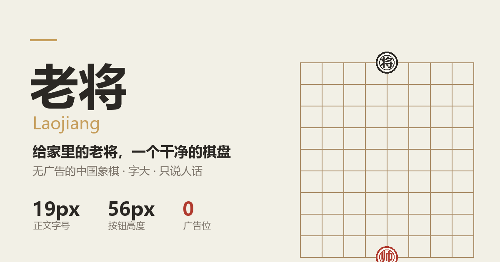

# Laojiang · 老将

**A clean chessboard for the veteran of the family.**

[中文](README.md) · [English](README.en.md) · [**Play it now**](https://dong-jay.github.io/xiangqi-elder/) · GPL-3.0



---

An ad-free Xiangqi (Chinese Chess) app designed for people who are not good with smartphones.

Big text, big buttons, plain language. It never says "depth 18 / 2.3M nodes / eval -0.35".
It says "You won this one" and "If you'd moved the cannon to the fifth file, you'd have kept your horse".

| 19px | 56px | 0 |
|:---:|:---:|:---:|
| body text<br><sub>most apps use 14px</sub> | button height<br><sub>thumb-friendly</sub> | ads · sign-ups · data uploads<br><sub>three zeros</sub> |

---

## Why I built this

My dad wanted to play chess.

I installed five apps for him. Every single one opened with a full-screen ad. Some wanted a
phone-number login. One wanted a subscription. Another shrank the board into a corner to fit a
"daily puzzle" banner next to it. The last one offered him coins for watching a video every time
he lost.

He stopped playing.

So I wrote this one. No account, no network required, no interruptions. When he loses, it tells
him which move to reconsider — in words he actually understands.

---

## What makes it different

| | Typical Xiangqi app | Laojiang |
|---|---|---|
| Colour | dark "tech" theme | light, high contrast |
| Text size | desktop-oriented | body text ≥ 19px |
| Buttons | small icons | touch targets ≥ 56px tall |
| Layout | landscape + side panel full of engine stats | portrait, single column, stats folded away |
| Vocabulary | depth / nodes / NPS / eval | plain words only |
| Move notation | `h2e2` | `炮二平五` (Chinese notation) |
| Game over | "Red wins!" | "You won this one!" |
| Feedback | visual only | visual + haptics + sound |
| Post-game | a move list | one plain-language coaching card |

---

## Features

| Feature | Detail |
|---|---|
| **No ads** | No third-party ad SDK anywhere in the codebase |
| **Match history** | Every game archived locally; win rate, streaks, last 10 games, exportable |
| **Adaptive difficulty** | Three wins in a row → engine gets stronger. Three losses → it eases off. And it tells the user why |
| **Coaching card** | After each game: one thing you did well, one move to reconsider, one tip for next time |

Two more things families tend to like:

- **Play your past self** — face the player you were three months ago
- **Two players, one phone** — pass-and-play, no second device

---

## Try it

| Entry | URL |
|---|---|
| **Play online** | [dong-jay.github.io/xiangqi-elder](https://dong-jay.github.io/xiangqi-elder/) |
| Mirror | [xiangqi-elder.app.workbuddy.host](https://xiangqi-elder.app.workbuddy.host/?sharecode=26PF7XBRIW) |

It's a PWA — open it in a mobile browser and "Add to Home Screen". After that it launches like a
native app and **works offline** with the first three difficulty levels.

---

## How it works

### Two engines

| Level | Engine | First load |
|---|---|---|
| 1 Beginner | Wukong (pure JS, 57KB, MIT) | **0 bytes** |
| 2 Easy | same | 0 bytes |
| 3 Intermediate | same | 0 bytes |
| 4 Advanced | Pikafish WASM + NNUE (GPL-3.0) | 49 MB |
| 5 Master | same | cached |
| 6 Grandmaster | same | cached |

The first three levels use a pure-JS engine weakened by search-depth limits plus a random
blunder rate. The top three use Pikafish and weaken it by sampling from the top MultiPV
candidates with a softmax temperature.

**Why not use the engine's own difficulty setting?** Pikafish descends from Stockfish but ships
without `Skill Level` / `UCI_Elo` / `UCI_LimitStrength`. Weaker play had to be built on top.

### Stack

- Pure static — no build step, no backend
- Engine runs in a Web Worker; the main thread never blocks
- Match history in IndexedDB (**local only, never uploaded**)
- One Service Worker handles both cross-origin isolation headers (COOP/COEP) and offline caching

---

## Development

```bash
# Serve over HTTP — file:// cannot get cross-origin isolation
python server.py
# → http://127.0.0.1:6324/

# Tests (jsdom needed on first run)
cd test && npm install
cd .. && bash test/run_tests.sh
```

**Before touching `sw.js`**: cross-origin isolation and offline caching must live in the *same*
Service Worker. A browser allows only one active worker per scope; splitting them makes the two
evict each other, which silently disables `SharedArrayBuffer` and kills levels 4–6. Also, cache
cleanup in `activate` may only remove keys prefixed `xiangqi-elder-` — deleting `pikafish-nnue-v1`
forces users to re-download 49 MB. Both constraints are covered by tests.

---

## Project layout

See the [Chinese README](README.md#项目结构) for the full annotated tree. Key pieces:

```
app/
├── js/elder.js        accessibility layer (font scaling, haptics, plain-language status)
├── js/notation.js     UCCI → Chinese move notation (h2e2 → 炮二平五)
├── js/review.js       template-based coaching engine
├── styles/elder.css   light high-contrast theme
└── sw.js              COOP/COEP injection + offline cache
```

---

## Credits & license

Built on top of [justa-cai/chess](https://github.com/justa-cai/chess) — the rules engine and
both chess engines come from that project.

**Licensed under GNU General Public License v3.0**, because the Pikafish engine is GPL-3.0 and is
compiled to WebAssembly and distributed with this app, so the copyleft covers the whole artifact.

See [`NOTICE.md`](NOTICE.md) and [`LICENSE`](LICENSE) for third-party attributions.

---

<p align="center">
  <sub>Built for my own dad.<br>
  If you also have a parent who wants to play but keeps getting interrupted by ads, I hope this helps.</sub>
</p>
